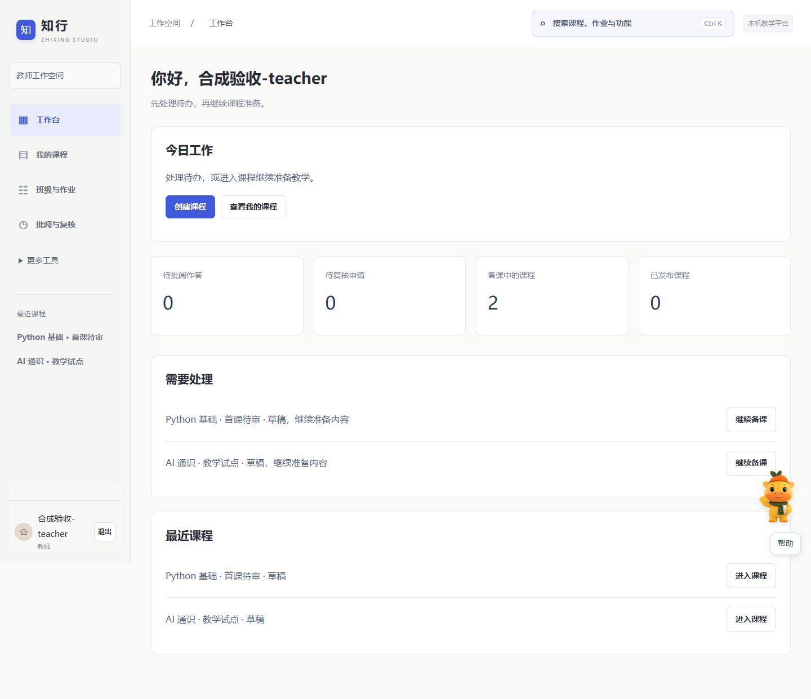

# 知行 · 插件化 AI 助教平台

把课程资料、知识点、练习、学习反馈和教师复核连接起来的教学工作空间。

当前版本：**前端易用版 v1 · 单一“小知”向导版**（2026-11-01）。面向管理员、教师和学生，提供备课、课程审核、班级作业、课程问答、批阅复核和课程质量检查。



## 选择体验方式

| 方式 | 用途 | 运行要求 |
| --- | --- | --- |
| 公开网页演示：`web/` | 体验角色与教学流程，使用浏览器本地合成数据 | 静态 HTTP 服务或 GitHub Pages |
| 完整教学平台：`platform/` | 独立账号、课程审批、作业与复核、模型与插件任务 | Windows、PowerShell 7、Node.js 24+、Python 3.10+、配套 DS-H 运行依赖 |

公开演示不需要账号或模型，不写入正式教学记录。GitHub Pages 仅承载公开演示，完整平台需要单独运行后端。

## 快速体验公开演示

在项目根目录运行：

```powershell
python -m http.server 4195 --bind 127.0.0.1 --directory web
```

打开 <http://127.0.0.1:4195/>，从教师、学生或管理员视角进入。部署到 GitHub Pages 的步骤见 [GitHub 发布指南](docs/GitHub发布指南.md)。

## Windows 启动完整平台

准备 PowerShell 7、Node.js 24+ 和 Python 3.10+。无需安装前端依赖或单独构建页面。

**使用便携包**：从项目 Release 下载 `zhixing-portable-v1.zip`，完整解压到可写目录，安装 Python 解析依赖后双击 `启动知行.cmd`。便携包包含 DS-H 依赖，不包含 Node.js、Python、PowerShell 或 Docker 本身。

**使用 Git 克隆或源码 ZIP**：先在项目根目录准备运行依赖，再安装解析依赖并启动：

```powershell
# 将 OWNER/REPOSITORY 替换为实际仓库；该仓库需先发布配套 Release 资产。
pwsh -NoProfile -File deploy/prepare-runtime.ps1 -Repository OWNER/REPOSITORY
python -m pip install -r platform/requirements-v08.txt
.\启动知行.cmd
```

已有本地依赖 ZIP 时，可将其复制到项目根目录并命名为 `知行_v0.8_DSH运行依赖.zip`，然后执行 `pwsh -NoProfile -File deploy/prepare-runtime.ps1`；脚本校验 SHA256 后还原依赖。

打开 <http://127.0.0.1:4180/>，首次初始化管理员账号，没有预置密码。之后由管理员创建教师账号，学生通过账号或班级邀请加入。操作见 [使用手册 PDF](docs/使用手册.pdf) 或 [Markdown 版](docs/使用手册.md)。

```powershell
# 只检查环境
pwsh -NoProfile -File platform/start-workspace.ps1 -CheckOnly
# 端口冲突时更换端口，仍按本机密钥配置选择模型
pwsh -NoProfile -File platform/start-benchmark.ps1 -Port 4181
```

需要真实模型时，在本机配置 `LONGCAT_API_KEY`，重新打开终端后启动。`启动知行.cmd` 会按密钥配置选择 LongCat-2.0 或本地模式；`.env.example` 仅供参考，启动脚本不自动加载 `.env`。程序题隔离执行还需要 Docker Linux 引擎和锁定镜像。

## 一次完整的教学流程

1. 教师创建课程草稿、上传资料，整理知识点、题目和评阅量规。
2. 教师审核并预览内容，提交课程发布申请，由管理员审批。
3. 教师建班、生成邀请、创建并发布作业快照。
4. 学生加入班级，进行课程问答、作答、查看学习记录和申请复核。
5. 教师批阅与反馈；更多工具提供教学数据生成、学生模拟、教学策略和自动评测集。

小知提供本地说明、分步引导和可选模型帮助。新生成内容先作为候选，经人工审核后采用。

## 项目结构

```text
├── web/                     公开演示网站，可发布到 GitHub Pages
├── platform/                后端、网页、插件、测试和启动脚本
├── docs/                    使用手册、示例截图和 GitHub 发布指南
├── output/                  运行所需的种子课包、来源和历史研究资料
├── deploy/                  源码检查、依赖下载及 GitHub 发布脚本
├── .github/workflows/       Pages 手动发布工作流
├── .env.example             模型环境变量示例（不含密钥）
└── THIRD_PARTY_NOTICES.md    第三方内容与许可说明
```

`output/` 中的课包和种子数据是运行所需内容，请保留。其下旧版 README、根目录 `交付说明.md` 和 `platform/README.md` 保留历史版本信息；当前启动入口与端口以本页和 11 月 1 日使用手册为准。

## 数据与发布

业务数据默认保存到 `platform/var/`，包括账号、SQLite 数据库、上传材料和备份，不提交到 Git。课程包、候选和轨迹属于有来源标记的种子或合成研究数据，技术检查与合成轨迹不代表真实学习收益。

DS-H 运行依赖与完整便携 ZIP 作为 **GitHub Release 资产**分发，不放入源码提交。下载标签为 `runtime-v0.8`（沿用依赖版本标签，界面版本仍为 v1），运行依赖哈希见 [runtime-asset.json](deploy/runtime-asset.json)。完整平台默认仅监听本机。

## 开发检查

```powershell
python deploy/check-public-source.py
# 完整离线回归需先准备 DS-H 和 Python 开发依赖
python -m pip install -r platform/requirements-dev.txt
node platform/scripts/check-benchmark.mjs
```

临时数据库位于忽略目录 `platform/var/`。模型实测和 Docker 沙箱验收需另外配置，不由离线检查替代。

## 许可

项目自身尚未指定开源许可证；第三方内容保留原许可，详见 [第三方内容说明](THIRD_PARTY_NOTICES.md)。
