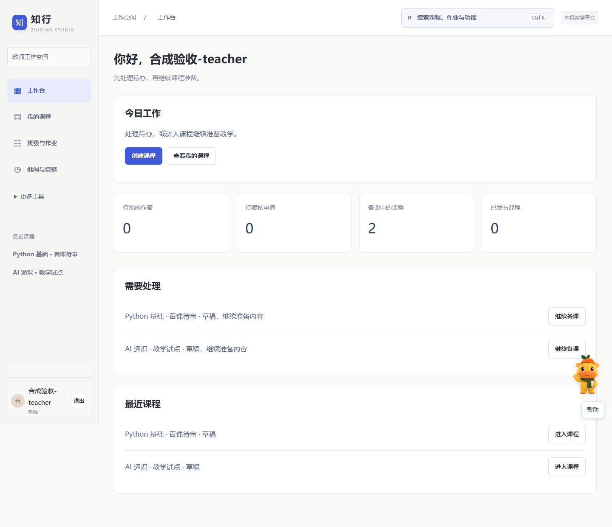
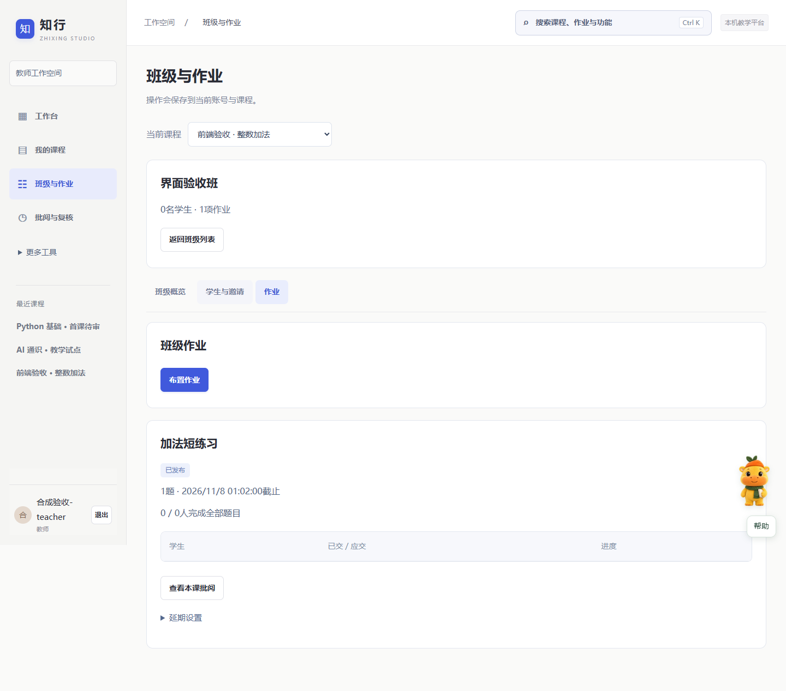
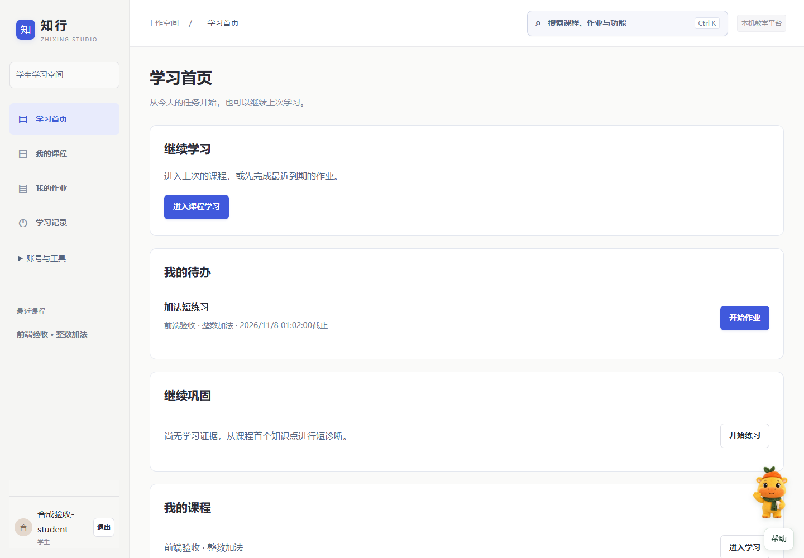

# 知行 · 插件化 AI 助教平台
## 项目说明与使用手册
前端易用版 v1 · 单一“小知”向导版
更新日期：2026年11月1日

从部署到师生操作的一本手册，配套“知行_前端易用版_v1.zip”。以当前布局 A 与 4180 端口的工作空间为准；源码中的早期端口、角色快捷切换及旧版流程仅作历史参考。

### 第一次使用，按这条路线走
1. 部署负责人解压源码，准备运行环境，启动服务。
2. 管理员初始化一次，创建教师账号；教师准备课程并提交发布申请。
3. 管理员批准课程后，教师建班、发邀请、发布作业；学生注册加入并学习。

### 按需求查阅
| 你要做什么 | 阅读位置 |
| --- | --- |
| 了解项目、职责和功能 | 第2页 |
| 在新电脑部署、连接模型 | 第3-4页 |
| 教师建课、审核发布、布置批阅 | 第5-7页 |
| 学生加入、提问、练习与复核 | 第8页 |
| 生成题目、学生模拟、策略与质量检查 | 第9-10页 |
| 小知帮助、备份、排错与完整演示 | 第11-12页 |

> 当前是本机教学试点与研究原型。技术流程可运行；正式教学发布仍需本人审核。自动检查、模型建议和合成学员轨迹不等于教师认可或真实学习收益。

<!-- pagebreak -->
# 01 项目说明：解决什么问题

知行面向教师与学生，把资料、知识点、练习、反馈和复核组织成一个课程内的教学流程。教师不用为每门课重建一套系统；课程内容放在课包，通用功能由内核与插件复用。

### 三种身份，各司其职
| 身份 | 主要入口 | 负责的事情 |
| --- | --- | --- |
| 管理员 | 管理概览、账号与平台管理、课程审批 | 创建账号、授权与课程归属、审批发布、运行治理 |
| 教师 | 工作台、我的课程、班级与作业、批阅与复核 | 创建草稿、准备和审核教学内容、建班布置、批阅讲评 |
| 学生 | 学习首页、我的课程、我的作业、学习记录 | 加入班级、课程问答、练习作答、提示复测、申请复核 |

### 技术怎样支撑这些流程
平台内核负责账号权限、学习状态、版本快照和审核记录。DS-H 负责工具与插件调用，LongCat-2.0 提供真实模型能力；SQLite 保存本机业务数据，Docker 为程序题提供隔离执行。前端是随源码运行的网页，无需单独构建。

### 当前能力与边界
- 资料导入、课程知识问答、客观核验、解释量规与教师复核构成教学闭环。
- 课程包支持多门课接入；随包示例涉及 Python、AI 通识、统计学和多语言程序题，不代表全部已正式发布。
- 教学数据生成、学生模拟、教学策略、自动评测集按插件启停和绑定课程；小知是平台级帮助插件。
- 评测自反馈优先补覆盖、复现问题；当前不自动替老师修改课程、批准内容、发布策略或改正式成绩。
- 尚未接入学校统一身份、选课和成绩系统；默认仅供本机访问。移动布局可检查，未默认开放手机跨设备连接。

<!-- pagebreak -->
# 02 新电脑部署：先让服务运行

### 准备环境
| 环境 | 是否必需 | 用途 |
| --- | --- | --- |
| Windows、PowerShell 7 | 当前推荐部署路径 | 运行随包启动脚本 |
| Node.js 24 或以上 | 必需 | 运行平台和 DS-H |
| Python 3.10 或以上及解析依赖 | 必需 | 课程资料解析与首次导入 |
| DS-H 运行依赖 | 已随源码包提供 | 首次启动自动解压、还原与校验 |
| LongCat API 密钥、可用额度和网络 | 真实模型功能需要 | 模型问答、生成与真实模拟 |
| Docker Linux 容器引擎、沙箱镜像 | 程序题需要 | Python / C17 / C++17 隔离核验 |

1. 完整解压源码包到本地可写目录，例如 D:\Projects\zhixing。不要在压缩包内直接双击运行，也不要只复制 platform 子目录。
2. 打开 PowerShell 7，进入解压后的项目根目录，安装 Python 解析依赖：
```powershell
python -m pip install -r .\platform\requirements-v08.txt
```
3. 双击根目录“启动知行.cmd”。首次还原 DS-H 可能需要等待；运行期间保持服务窗口打开。
4. 浏览器打开 http://127.0.0.1:4180/。首次由负责人初始化管理员，其余人通过账号或邀请进入。

### 自检或端口冲突
```powershell
# 只检查环境，不启动正式服务
pwsh -NoProfile -File .\platform\start-workspace.ps1 -CheckOnly
# 4180 已被占用时，改用 4181；仍保留模型配置判断
pwsh -NoProfile -File .\platform\start-benchmark.ps1 -Port 4181
```
已有独立 Python 环境时，先设置 TUTOR_PYTHON 为其 python.exe 完整路径，再运行启动脚本。源码包已带 DS-H 依赖，不需要额外执行 npm install。

<!-- pagebreak -->
# 03 模型配置与管理员初始化

### 本地模式与真实模型的区别
未配置密钥时，平台仍提供明确标注的本地规则与资料流程；复杂自由问答、真实生成和真实学生模拟需要 LongCat。本地成功不能当作真实模型联调成功。

1. 在 Windows 中搜索“编辑账户的环境变量”。
2. 在用户变量中新增 LONGCAT_API_KEY，值填写你自己的 LongCat 密钥；不要发到聊天或写进源码。
3. 关闭并重新打开启动终端，然后运行“启动知行.cmd”。启动脚本会自动判断环境密钥，并选择 LongCat-2.0 或本地模式。
4. 在课程问答的模式说明或教师预览的运行方式中确认。插件和质量检查另有离线／LongCat 选项，应按需要明确选择。

> 简单问候和小知常见问题会走本地路径。即使模型已接通，这些请求仍可能是零模型调用；应以该次请求的运行记录判断。

### 管理员第一次需要做什么
1. 仅首次部署时创建一个负责人管理员；账号使用3-48位字母、数字、下划线或连字符，密码至少10位。没有默认公开密码。
2. 进入“账号与平台管理 → 账号与授权”，在“本机账号”创建教师账号，转交账号与初始密码。
3. 教师可自行创建草稿；已有课程要交给某教师时，先选择“当前课程”，再在“授权当前课程”选择教师并授予权限。
4. 在“课程审批”核对教师提交的内容、归属和审核状态，填写依据后批准或退回。

同一浏览器普通标签页共享登录身份。逐个角色体验时先退出再登录，或使用不同浏览器／隐身窗口。源码包不带原部署机器的账号和数据库，新部署需要自行初始化。

<!-- pagebreak -->
# 04 教师备课：先保存草稿，再补内容

### 建课前准备一份最小材料包
准备课程名称与院系、1-2份清晰的文本资料、首批知识点与学习目标，以及每个知识点至少一道练习、答案、解析和评分依据。建议先做一个小章节，确认完整流程后再扩展。

1. 教师登录，在工作台点击“创建课程”，填写课程名称、院系和负责教师，选择“保存草稿并继续备课”。课程编号自动生成。
2. 在“课程资料”上传文本型 PDF、DOCX、Markdown、TXT 或 HTML。保留真实资料出处，查看解析原文及定位；无需填写已删除的许可表单项。
3. 点击“添加知识点”，填写名称、学习目标、教学说明与解释要点，选择关联资料、实际原文片段和引用原文，再保存。
4. 进入“题目与评分”，点击“手动添加练习”，填写题干、参考答案、参考解析和评分要点；题目先作为待审内容保存。
5. 需要自动准备题目时，从“更多工具 → 插件实验室 → 生成候选”开始，审核后采用到草稿，不能直接当作正式题目。


截图展示顶部区域，来自独立合成验收库；课程与姓名不是正式教学数据。

> “继续备课”会根据已有内容定位后续环节。步骤有内容不等于已获批准；扫描件暂不支持 OCR，解析不完整时应换成文本资料。

<!-- pagebreak -->
# 05 题目审核、教学预览与发布

### 先把内容改完，再集中审核
1. 展开题目，用普通表单修订正确要点、可接受表达、典型误区及解释是否必填。高级版本信息和课包 JSON 可以暂不使用。
2. 核对答案、解析与量规一致后，填写“修订审核依据”，点击“审核通过当前保存版本”。资料也需核对原文并填写资料审核依据。
3. 在“教学预览”先选本地规则，检查问答、分配练习、提示和反馈；要验证模型时明确选择 LongCat 真实模型预览。预览使用独立合成学员，不写入正式学生统计。
4. 进入“审核与发布”，处理发布检查中的缺口，填写发布申请说明并提交。
5. 管理员批准后才向班级学生开放；退回时按原因修改，并重新检查本次版本的审核。

### 发布前的门槛
| 检查对象 | 应满足的条件 |
| --- | --- |
| 知识点 | 有教学资料证据与对应练习 |
| 资料、题目与量规 | 本人核对，审核绑定当前版本 |
| 程序题 | 具有有效隔离沙箱核验记录 |
| 课程发布 | 教师提交，管理员明确批准 |

修改课程或题目后，相关旧审核可能失效；已发布内容需走修订版流程。不要为了通过发布检查而填入虚构审核依据。

### 例如新增“线性代数”
先做“矩阵乘法”一节，准备一份有公式文字或可读说明的资料，配置“维度条件、计算规则、不可交换性”三个知识点及对应练习。开放推导先用量规与人工复核；程序核验和数值容差只覆盖其支持的题型，不代表自动验证全部数学证明。该例是建课建议，不是随包已发布课程。

<!-- pagebreak -->
# 06 教师建班、布置与批阅

1. 进入“班级与作业”，选定课程并“创建班级”；进入该班级的“学生与邀请”，生成学生邀请码。
2. 及时复制并转交邀请码。原码只在生成时显示；列表可检查有效期、撤销失效邀请，需要时重新生成。
3. 在班级的“作业”中点击“布置作业”，从已审核题库选择1-5题，填写名称、截止时间和章节信息。
4. 先预览学生会看到的题目，保存作业草稿，再“确认发布作业”。草稿已固定题目、量规与策略快照；发布后更改内容需新版本。
5. 查看班级进度和提示依赖等信号；到期后停止新增正式提交，确需延期时通过教师入口修改并保留记录。
6. 进入“批阅与复核”，优先处理学生申请。读取原始答案、解释、提示记录和系统反馈，填写结论、修正反馈与依据。
7. 保存后学生能在学习记录看到有效反馈；原作答不会被覆盖。使用“导出讲评与投入记录”整理讲评材料。


截图展示顶部区域，为独立验收库的合成作业；不代表实际教师批准。

> 客观答案错误、解释矛盾和规则未识别是不同信号。共性统计用于定位待办，不能把所有自动信号直接当作教师确认的错误。

<!-- pagebreak -->
# 07 学生从加入到继续学习

1. 收到教师邀请码后，在登录页选择“邀请码注册”，创建自己的账号并确认参与说明；已有学生账号则登录后点击“加入班级”。
2. 在学习首页“我的待办”或“我的作业”打开教师作业；也可从“我的课程”进入课程学习。
3. “课程问答”中输入问题，Enter 发送，Shift＋Enter 换行。支持继续会话、停止生成和显式重试；资料依据与模型补充分开标注。
4. 在“练习与作业”分别填写答案和解释，再提交。需要时请求提示；提示记录会保留，不会因为之后答对而算独立完成。
5. 反馈先看结果，再看判断依据和下一步。解释未被规则识别，不等于已经认定理解错误；有异议点击“申请教师复核”。
6. 在“本课学习记录”查看原始与有效反馈。全部题已提交的作业会移到最近完成；已完成不等于已经掌握。
7. 登录后可看到订正、新结构练习与到期复测建议；题库不足时会明确提示，不把重复题伪装成迁移题。


截图展示顶部区域，为独立合成学生；真实学生应使用自己的账号与邀请。

> 学生不能上传课程资料、建课、发布课程或管理教师题库。遇到这些需求应联系任课教师。未提交文本有草稿保护，文件需重新选择；退出会清理当前界面的账号缓存。

<!-- pagebreak -->
# 08 插件实验室：按需要使用

教师从“更多工具 → 插件实验室”进入，先核对当前课程、插件已启用及课程已绑定。管理员负责插件启停；教师只操作获授权课程。普通学生不需要进入实验室。

| 插件 | 作用 | 人工门槛 |
| --- | --- | --- |
| 教学数据生成 exercise_factory | 按资料与知识点生成概念、数值或程序候选 | 候选审核、采用到草稿后课程题目再确认 |
| 学生模拟 student_simulator | 模拟独立、矛盾、提示依赖、不确定四类表现 | 人工检查是否真正出现目标行为 |
| 教学策略 teaching_policy | 对照追问、先例后概念、分层提示、迁移策略 | 验证候选，人工审核后显式发布 |

### 生成一道候选题
选择“生成候选” → 依据资料、知识点、题型与数量 → 先离线试用，再按需要选 LongCat → 点击生成 → 查看任务与技术检查 → 填写人工审核依据 → 采用到草稿 → 回课程审核。隔离候选应先修订核验，不能直接采用。

### 做一次学生模拟
选择行为、教学策略与最大轮数 → 选择离线或 LongCat → 运行 → 查看学生发言、助教回应、状态变化与检查项。模拟未表现指定行为时如实记录；它不是学生真实学习数据。

### 比较一次教学策略
运行固定脚本对照 → 保存策略草稿 → 独立验证 → 达标后人工审核 → 显式发布。未改善的候选不应发布；保留回退入口。日常师生使用固定发布版本，不跟随后台实验自动切换。

### 程序题的额外条件
需要 Docker Linux 容器服务可用。在项目根目录运行 node platform/scripts/prepare-sandbox.mjs，按锁定摘要准备镜像。程序使用 stdin/stdout，支持 Python 3.13、C17、C++17 与标准库；无沙箱时不在宿主运行模型代码。

> 插件任务串行排队。取消或重启后先核对已完成步骤，再显式恢复；付费结果未知时不得盲目重复提交。教师版导出可能包含答案和私有测试，不应转给学生。

<!-- pagebreak -->
# 09 课程质量检查：老师只处理结论与待办

入口：“更多工具 → 课程质量检查”。evaluation_factory 把生成评测候选、核验、运行真实助教流程与失败归因放在独立研究空间，不改正式学习状态，也不向学生题库自动写题。

1. 选定课程；首次使用按提示“为本课程启用质量检查”，插件被禁用时联系管理员。
2. 点击“新建检查”，选择运行模式、资料版本和知识点。初次用小批量离线检查，高级参数保持默认。
3. “创建检查”只保存记录；再点击“开始检查”才执行。LongCat 模式会产生真实模型调用。
4. 完成后看“本课检查概览”“需要处理的事项”和“建议下一步”。教师核对教学内容，维护者排查运行和检索问题；事项分工是建议，不会自动派单。
5. 打开关联案例，比较公开题目、模拟学生输入、私有参考与实际反馈。填写审核，或导出“教师审核表”和“检查摘要”。离线填写 CSV 不会自动批准内容。
6. 需要时在高级详情查看轨迹、恢复任务和导出参考；“冻结研究快照”后只读，继续检查应新建记录。

### 自反馈实际改变的是什么
资料证据与覆盖表生成小批候选 → 运行固定版本助教 → 记录失败和缺口 → 选择下一轮类别。客观失败需在两个全新隔离状态中重复，才列为可复现；开放判断保留人工复核。自动反馈改进的是评测集覆盖与问题发现，不等于助教已自行升级。

| 状态或指标 | 应怎样理解 |
| --- | --- |
| 技术通过／待教师审核 | 格式、引用或程序等检查通过；不代表内容已获教师认可 |
| 已隔离／失败 | 先查题目、参考或环境，不直接归咎于助教 |
| 六项指标 | 价值、应用效果、方案设计、创新、体验、规范分别给证据，不合成无依据总分 |
| A/B/C 研究对照 | 比较评测集方法的问题发现能力；不同题集通过率不直接证明助教进步 |

学生无需管理这些记录；任课教师优先处理教学待审事项，技术轨迹与实验配置由维护者管理。

<!-- pagebreak -->
# 10 小知帮助与运行维护

### 小知：一个角色，两个帮助方式
右下角“小知”已合并原小行的能力。“问一问”解释平台功能，“操作引导”分步找到入口，“使用说明”阅读本地文档。常见问题零模型调用，复杂帮助才可能使用 LongCat。

- 点击角色打开，拖动可移动；右键或“菜单”可本次隐藏、关闭主动提示、减少动画、清除帮助记录。
- 固定“帮助”按钮可召回；方向键移动，Shift＋F10 打开菜单，Esc 关闭。
- 原小行用户会显示小知，位置、偏好、帮助记录及引导进度保留。账号权限不会随帮助内容改变。
- 小知不会代填、批准、发布或评分；课程知识问题请回课程问答。清除帮助记录不会清除课程学习记录。

### 模型用量与异常任务
管理员进入“账号与平台管理 → 平台运行”，查看“模型任务与估算成本”。累计请求与费用默认不限，可按部署需要设置额度；估算不是账户账单。配置本身不等于每次请求成功，以任务记录为准。

### 数据在哪里，怎样备份
当前工作空间默认在 platform/var/workspace-v1/，主库为 platform.sqlite，资料及备份也存于运行目录；模型账本等还可能位于 platform/var 的其他位置。不要把整个 var 目录作为公开源码转发。

1. 平台内可点击“创建数据库备份”，留存备份编号。
2. 升级或迁移前停止服务窗口，再完整复制 platform/var 目录到安全位置；只复制正在写入的 SQLite 主文件可能漏掉 WAL 数据。
3. 恢复前停止服务，并由维护者核对工作空间路径和端口；历史恢复脚本的默认目录可能不同，不能直接照抄旧版命令。

### 保留与清理
平台运行中先预览过期记录，再按当前期限确认并清理；默认90天，清理前自动备份。它是需管理员执行的流程，不是承诺所有副本自动到期删除；历史备份另行管理。学生只导出本人记录，教师仅访问授权课程。

<!-- pagebreak -->
# 11 常见问题与一次完整演示

| 问题 | 先检查什么 |
| --- | --- |
| 每个人都要创建管理员吗 | 不用。仅首次初始化一次；教师和学生用账号或邀请 |
| 教师登录后看不到已有课程 | 管理员先选对课程，授予该教师权限；自行新建草稿走教师建课 |
| 学生看不到课或作业 | 邀请有效、已加入对应班、课程已批准发布、作业已发布 |
| 模型接通却只给本地回答 | 检查该功能运行模式；问候和小知常见问题本来就走本地 |
| 资料不足或引用不支持问题 | 补充可定位的原文、正确关联知识点；不要用虚构证据补齐 |
| 输出正确但解释待确认 | 量规未识别不等于理解错误，申请教师复核 |
| 程序题或真实调用失败 | 查 Docker Server、镜像、模型密钥、额度与网络；失败不自动变成功 |
| 页面保存失败或请求结果未知 | 保留输入，先查列表与任务，确认后显式重试，避免重复计费 |
| 页面还是旧版／打不开 | Ctrl＋F5；确认启动窗口、端口和新服务；换电脑的127.0.0.1指向它自己 |

### 建议这样走一遍
1. 管理员：创建一个教师账号，退出。
2. 教师：创建“小章节体验课”，上传一份 TXT 或 Markdown，整理一个知识点与一道练习；完成审核、教学预览、申请发布。
3. 管理员：查看审批依据，批准这门体验课，退出。
4. 教师：建班、生成邀请，选题、预览并发布一份作业。
5. 学生：用邀请注册加入，提问，填写答案与解释，试一次提示并提交，再申请教师复核。
6. 教师：打开待复核作答，追加反馈与依据；学生重新登录查看有效反馈。
7. 教师／维护者：可选运行一小批离线质量检查或学生模拟，导出记录；不把合成结果计入正式学习效果。

### 这版已验证到哪里
179项回归通过；前端24条流程、既有质量检查13条流程及单一小知7条专项流程通过，页面错误0。浏览器使用独立合成账号和审核夹具；干净目录启动是在同机进行。真实教师审核、另一台设备及真实师生可用性和学习效果仍需实际验证。

依据：当前启动脚本、前端页面、账号与权限实现、插件界面及 output/frontend-v1 的验证记录。后续升级时以同包的最新说明为准。
